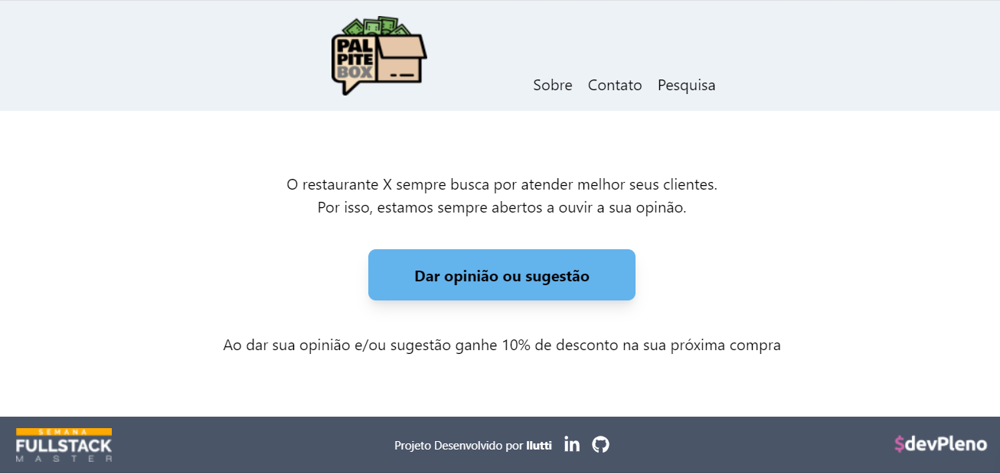

# Projeto *PalpiteBox*

[](http://hits.dwyl.com/llutti/llutti/palpitebox)

Uma caixa de sugestoes na qual os clientes podem deixar opinioes e sugestoes sobre estabelecimentos comerciais e, em troca, receber cupons de desconto e vantagens.



### Pre-requisitos

- [Node.js](https://www.nodejs.org) 22 ou superior
- NPM, instalado junto com o Node.js
- Editor de codigo, como [Visual Studio Code](https://code.visualstudio.com/)
- Credenciais de service account para acesso a uma planilha do Google Sheets

### Variaveis de ambiente

Crie um arquivo `.env.local` com base em `.env.example`:

```env
SHEET_CLIENT_EMAIL=<client email do service credential>
SHEET_PRIVATE_KEY=<private key do service credential em base64>
SHEET_DOC_ID=<id da planilha>
```

## Construido com

- [Node.js](https://www.nodejs.org) >= 22
- [Next.js](https://nextjs.org/) 16
- [React](https://react.dev/) 19
- [TypeScript](https://www.typescriptlang.org/) 5
- [Tailwind CSS](https://tailwindcss.com/) 4
- [Figma](https://figma.com/)
- [SWR](https://swr.vercel.app/)
- [Google Sheets API](https://developers.google.com/sheets/api)
- [Luxon](https://moment.github.io/luxon/)
- [React Icons](https://react-icons.github.io/react-icons/)

## Instalacao

```bash
npm install
```

## Scripts disponiveis

- `npm run dev` - inicia o ambiente de desenvolvimento na porta 7000.
- `npm run build` - gera a versao de producao.
- `npm run start` - inicia a aplicacao em modo producao.
- `npm run start:dev` - inicia a aplicacao em modo producao na porta 7000.
- `npm run lint` - executa o ESLint.

## Author

* **Luciano Cargnelutti** - [LinkedIn](https://www.linkedin.com/in/llutti/)

## Licenca

Este projeto e licenciado sob a licenca MIT - veja [LICENSE.md](LICENSE.md) para mais informacoes.

## Acknowledgments

* Projeto desenvolvido durante o workshop online **Semana Fullstack Master** do [DevPleno](https://devpleno.com).
